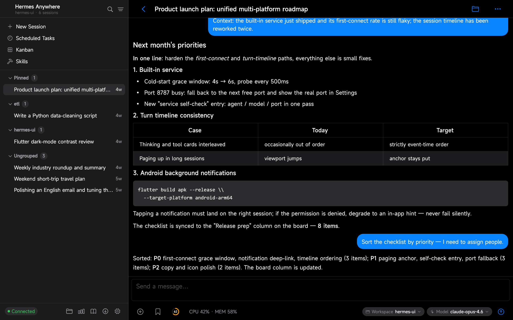
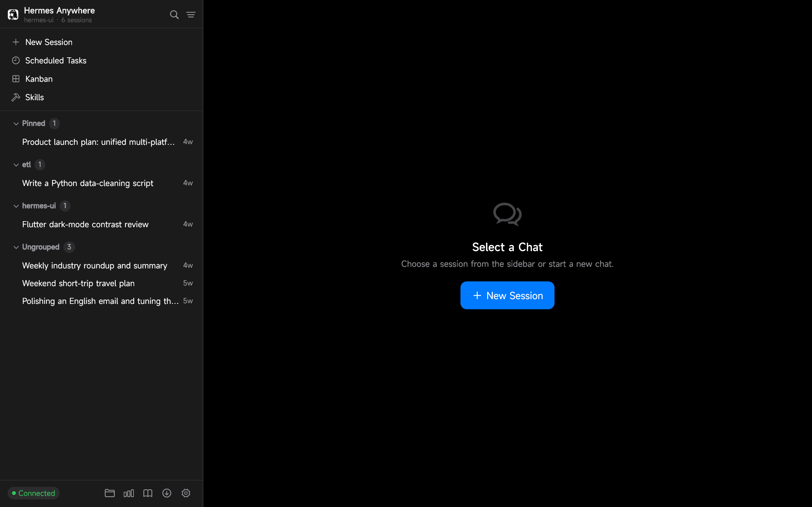
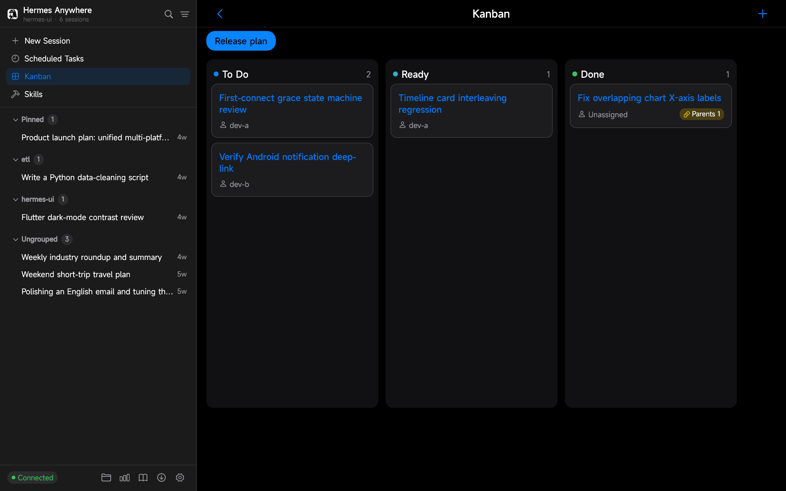
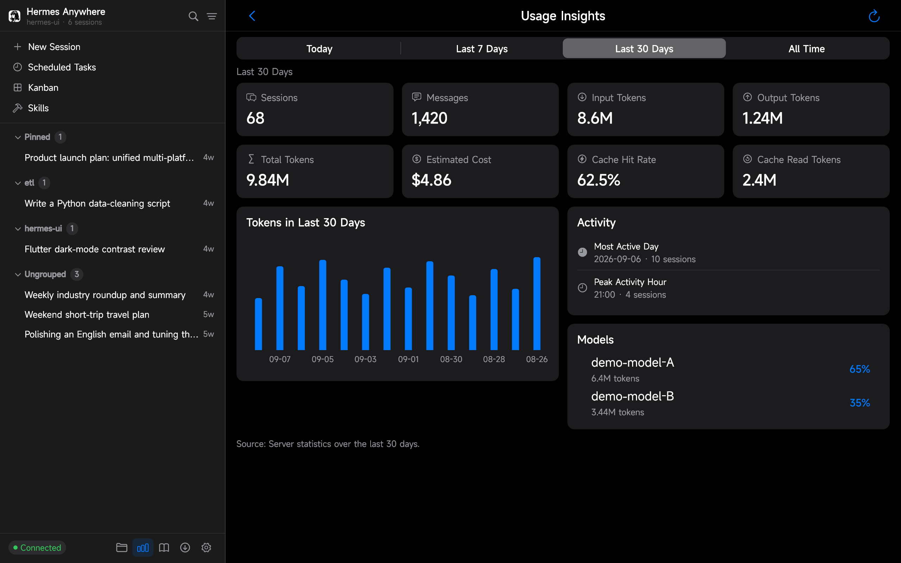
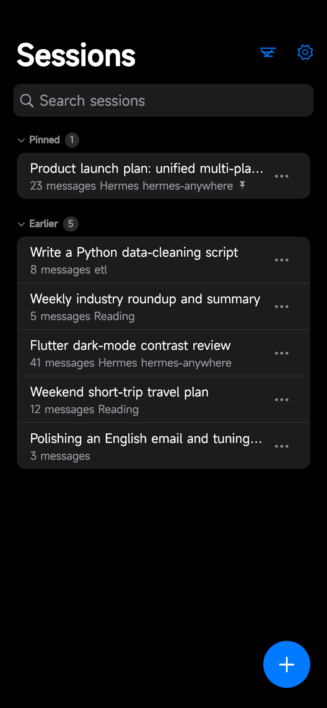
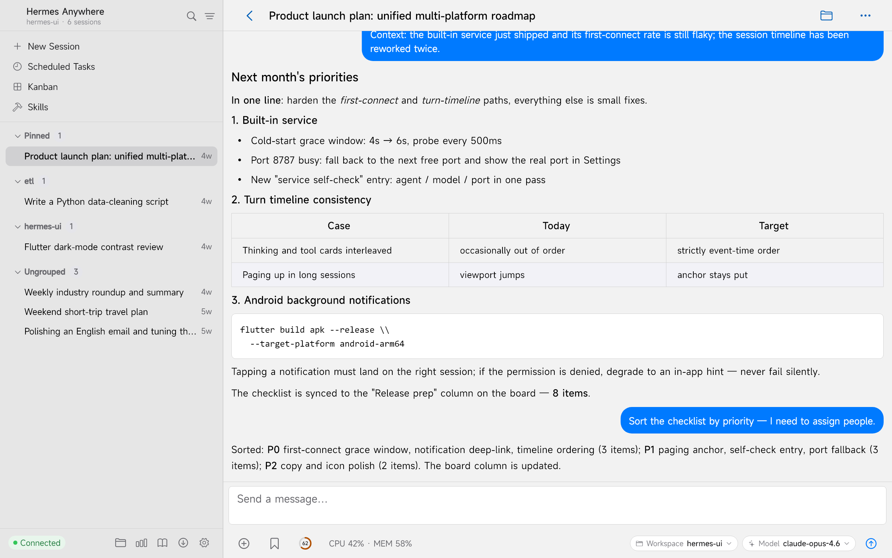
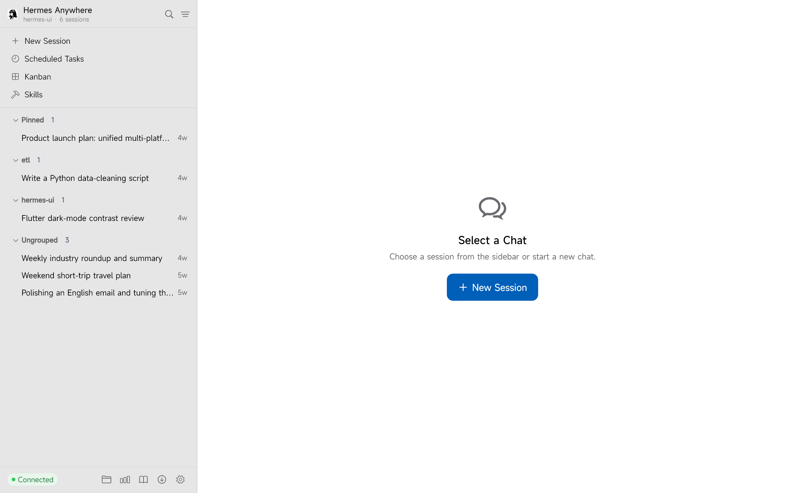
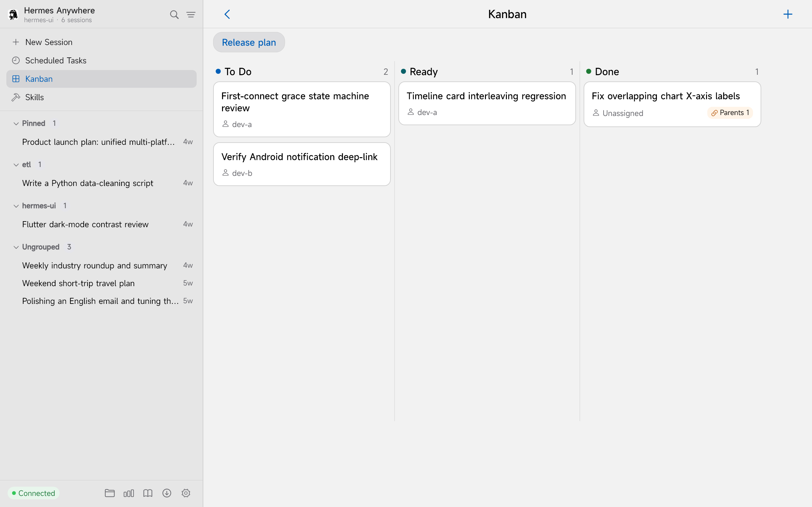

<div align="center">

# Hermes Anywhere

**One smooth Hermes experience, everywhere.**

A Flutter + Cupertino client for [Hermes Agent](https://hermes-agent.nousresearch.com/docs) — one codebase, consistent chat on desktop and phone.

[](https://github.com/silent-reader-cn/hermes-keep/actions/workflows/ci.yml)
[](LICENSE)
[](https://github.com/silent-reader-cn/hermes-keep/releases)


**English** | [简体中文](README.zh-CN.md)

</div>

---

## Screenshots

**Windows desktop** — your sessions on the left, the conversation on the right: streamed Markdown answers, reasoning and tool cards, steer mid-turn.



<div align="center">

| Sessions | Kanban | Insights |
|---|---|---|
|  |  |  |

**Android phone** — the same chat, the same sessions, in your pocket.

| Chat | Sessions | Insights |
|---|---|---|
|  |  |  |

**Light or dark** — every screen ships in both, and the theme follows the system by default.

| Chat | Sessions | Kanban |
|---|---|---|
|  |  |  |

</div>

## Why this one

**One codebase, two platforms.** A Windows desktop app and an Android phone app built from the same
Flutter + Cupertino codebase — the same layout, the same features, the same bilingual UI on both.
Start a turn at your desk, pick it up from your phone.

That is the point of the project: not a port of any single-platform client, but one client that
behaves the same everywhere it runs.

## Highlights

- **Bundled WebUI sidecar (Windows)** — the installer ships a self-contained WebUI backend with an embedded Python 3.11 runtime: no pre-installed Python, Git, or compilers required. Start it and connect in one click, Clash-Verge style.
- **Reuses your Hermes install** — startup looks for an existing Hermes Agent and reuses its virtualenv, so chat works out of the box. With none installed, the bundled runtime still serves your session history read-only.
- **Streaming chat** — SSE streaming with Markdown + code blocks, reasoning and tool-call cards, steer and stop mid-turn, model picker, per-session drafts.
- **Attachments** — multi-image messages lay out as one tidy justified row each (equal height, no cropping, no gaps); other files render as compact rows; image loading can be gated to a tap via **Settings → Auto-load Images**.
- **Downloads** — a queue with live progress, resume from a partial file, and cancel.
- **Sessions** — search, pin / archive / branch / delete, a sectioned list (pinned / today / earlier), offline cache, and the session you are reading highlighted in the sidebar.
- **Tasks (cron)** — create, edit, enable/disable, run on demand, read the output, watch run-status badges.
- **Skills & memory** — browse and filter skills; read and edit memory.
- **Workspace & Git** — browse, upload and download workspace files; branch switching, status, diffs, commit, fetch / pull / push.
- **Kanban** — boards and cards with drag & drop across columns.
- **Insights** — today / 7 days / 30 days / all-time; session, message, token and cost metrics with a per-model breakdown and token chart.
- **Notifications (Android)** — background turn-completion notifications that deep-link back to the conversation.
- **Made for wide screens** — desktop pages open as two panes (skills, tasks, workspace, Git, diagnostics, downloads, settings) instead of one stretched column.
- **Desktop extras** — tray icon, global hotkeys, window-state memory, launch-on-login, and 100–200% UI scaling for HiDPI displays.
- **Appearance** — light / dark / follow system, plus an adjustable page background (six presets or your own hue and lightness).
- **Bilingual UI** — English / 简体中文 / follow system.

## Installation

### Windows

1. Grab the latest installer `HermesAnywhere-<version>-x64-setup.exe` from the [Releases](https://github.com/silent-reader-cn/hermes-keep/releases) page and run it.
2. Launch **Hermes Anywhere**. On the onboarding screen pick **Built-in service** → **Start & Connect**. That's it — the WebUI backend starts automatically.

Chat requires a [Hermes Agent](https://hermes-agent.nousresearch.com/docs) installation. If none is detected, the onboarding screen shows a card linking to the install guide; without it the app still works in read-only mode (session history), and attempting to chat will tell you what's missing.

### Android

Download `app-release.apk` from the [Releases](https://github.com/silent-reader-cn/hermes-keep/releases) page (Android 7.0+, arm64) and connect it to your Hermes server on the network.

### macOS

Download `HermesAnywhere-<version>-macos-arm64.zip` from the [Releases](https://github.com/silent-reader-cn/hermes-keep/releases) page. The app is not signed or notarized yet, so clear the quarantine flag before opening it:

```bash
xattr -cr hermes_ui.app
open hermes_ui.app
```

Apple Silicon only, for now.

### Linux

Download `HermesAnywhere-<version>-linux-x64.tar.gz`, unpack it and run — the bundle ships its own mpv/ffmpeg runtime, so a standard desktop needs nothing extra:

```bash
tar -xzf HermesAnywhere-<version>-linux-x64.tar.gz
./hermes_ui
```

Built on Ubuntu 22.04 (glibc 2.35+) to cover both 22.04 and 24.04.

> The macOS and Linux packages are **experimental**: CI builds them and smoke-starts each one (see [`.github/workflows/release-platforms.yml`](.github/workflows/release-platforms.yml)), but they have not had a full hand-test on real hardware yet. Reports welcome via issues.

### Build from source

```bash
git clone https://github.com/silent-reader-cn/hermes-keep.git
cd hermes-keep
flutter pub get

# Windows desktop
flutter run -d windows

# Android device / emulator
flutter run -d <device-id>
```

Requirements: Flutter 3.47+ (stable), JDK 17 + Android SDK 36 for Android builds, Visual Studio Build Tools 2022 (C++ desktop workload) for Windows builds.

## Connecting to a server

Two connection modes, configured on the onboarding screen or in Settings → Servers:

| Mode | When to use | What you need |
|---|---|---|
| **Built-in service** (Windows) | You just installed the app on the same machine that runs Hermes | Nothing — the app starts and connects to its own bundled WebUI automatically |
| **Remote server** | You already run hermes-webui (or the built-in sidecar) elsewhere — a home server, VPS, or your PC | Host, port, and password (or username + password / API key) |

Multiple server profiles are supported with one-tap switching. Credentials are stored in the system secure storage.

The API contract is aligned with **[nesquena/hermes-webui](https://github.com/nesquena/hermes-webui)** (MIT), the community Hermes WebUI.

> **Disclaimer**: this is an independent community project, not affiliated with or endorsed by Nous Research.

## Tech stack

| Domain | Choice |
|---|---|
| Framework | Flutter 3.47+ / Dart 3.13+ |
| UI | Full Cupertino widget set (no Material in business UI) |
| State | flutter_riverpod 2.x |
| Networking | dio 5.x + custom SSE client + web_socket_channel |
| Routing | go_router 17.x |
| Markdown | flutter_markdown (custom renderers) |
| Storage | drift (SQLite) + flutter_secure_storage |
| Charts | fl_chart |
| Testing | flutter_test + mocktail + fake_async |

## Project status

Actively developed. Every release ships a signed Windows installer (WebUI sidecar bundled) and an Android arm64 APK; the current release also carries CI-built macOS (Apple Silicon) and Linux x64 packages — experimental, in that they are built and smoke-started by CI but not yet fully hand-tested. Behind all of it: 5,600+ automated tests and a clean `flutter analyze`. See the [changelog](CHANGELOG.md) for details.

## License

Released under the [MIT License](LICENSE). Bundled third-party components (the embedded hermes-webui server, embedded Python, and their dependencies) retain their original licenses; notices are collected in [THIRD-PARTY-NOTICES.md](THIRD-PARTY-NOTICES.md).

## Acknowledgments

- [Hermes Agent](https://github.com/NousResearch/hermes-agent) by Nous Research — the agent engine this client talks to.
- [nesquena/hermes-webui](https://github.com/nesquena/hermes-webui) — the community WebUI whose API this client aligns with, and whose server ships inside the Windows bundle.
- [uzairansaruzi/hermex](https://github.com/uzairansaruzi/hermex) — early UI inspiration (iOS SwiftUI client, MIT).
