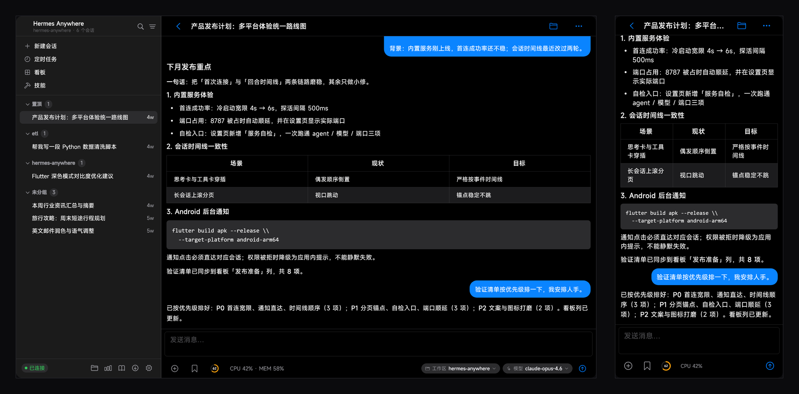
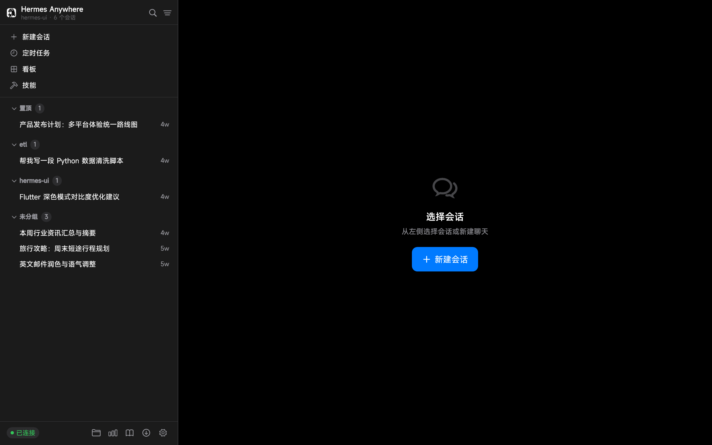
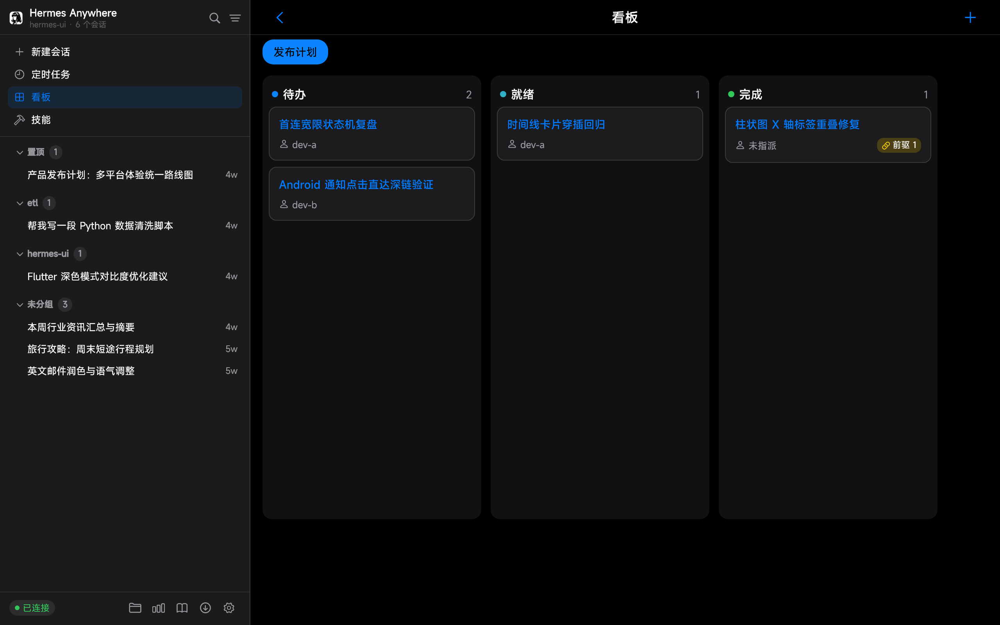
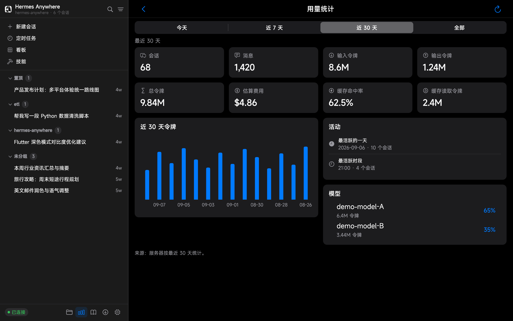
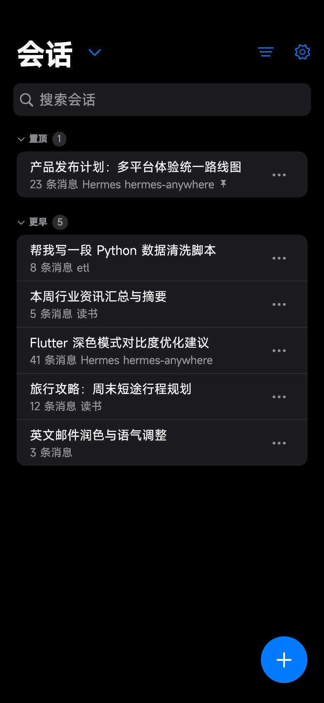
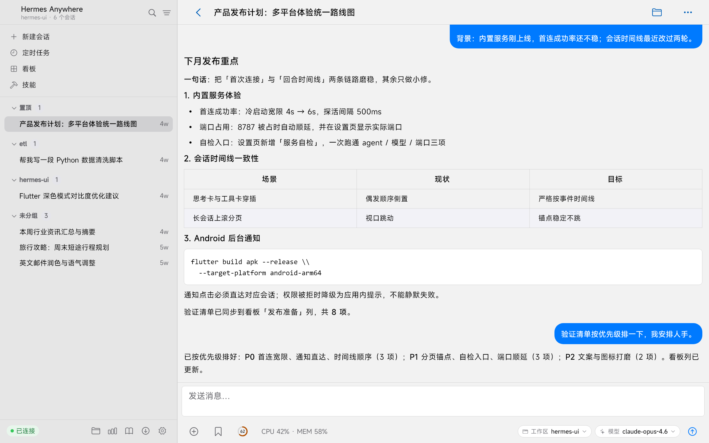
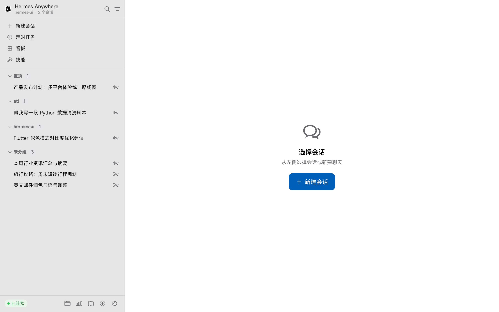
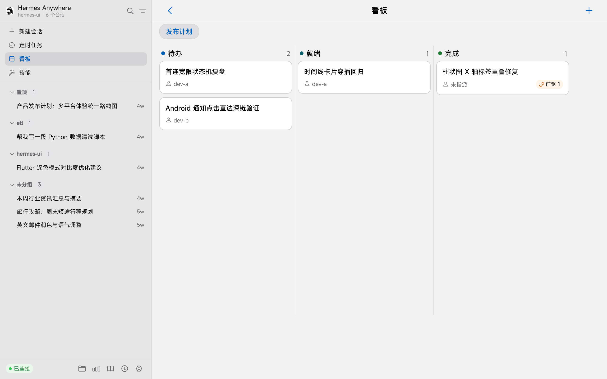

<div align="center">

# Hermes Anywhere

**桌面上和口袋里是同一个 Hermes 客户端——一套代码、一套界面、同一份会话。**

基于 Flutter + Cupertino 的 [Hermes Agent](https://hermes-agent.nousresearch.com/docs) 客户端。
Windows 与 Android 是**同一个应用**：同一套侧栏、同一套思考与工具卡片、同一份逐会话草稿、同一套明暗主题、同一套中英双语界面——不是网页套壳，不是两套代码库，也不是「Mac 原生 + 手机版补丁」。

[](https://github.com/silent-reader-cn/hermes-anywhere/actions/workflows/ci.yml)
[](LICENSE)
[](https://github.com/silent-reader-cn/hermes-anywhere/releases)


[English](README.md) | **简体中文**

</div>

---

## 截图

**一个应用，两块屏幕。** 同一个会话分别在 Windows（左，带会话侧栏）与 Android（右）上打开——同样的对话、同样的思考与工具卡片、同样的主题。



<div align="center">

| 会话列表 | 看板 | 用量统计 |
|---|---|---|
|  |  |  |

**Android 手机** —— 同一个聊天界面、同一套会话，装进口袋。

| 聊天 | 会话列表 | 用量统计 |
|---|---|---|
|  |  |  |

**浅色 / 深色** —— 每个页面都有两套，默认跟随系统。

| 聊天 | 会话列表 | 看板 |
|---|---|---|
|  |  |  |

</div>

## 为什么选它

Hermes 已经有不少好客户端。各类选择给你什么、又缺什么，摆在一起看：

| 你在用… | 得到什么 | 缺什么 |
|---|---|---|
| Web UI（hermes-webui、hermes-workspace） | 浏览器里功能齐全的仪表盘，免安装 | 它是个网页：手机上控件按鼠标尺寸设计，没有原生窗口、没有托盘、没有全局热键 |
| macOS 原生客户端 | 完整的 Mac 原生体验 | 只有 macOS，Windows 与 Android 用户拿不到对应物 |
| 只做桌面的伴侣应用 | 桌面上装完即聊 | 手机端是另一个客户端，或者干脆没有 |

**Hermes Anywhere 是同一套 Flutter + Cupertino 代码库**，所以 Windows 与 Android 是真正一致的界面：同一套三栏布局、同一套思考与工具卡片、同一份逐会话草稿、同一套明暗主题、同一套中英双语界面。桌面端开一个回合，手机上接着聊。

Windows 安装包还把后端一并带上：内置 WebUI 服务与自带的 Python 3.11 运行时，无需预装 Python、Git 或编译器——选「内置服务 → 启动并连接」就能直接聊。宽屏是设计目标而非拉伸结果：需要的地方以双栏展开，而不是把单栏拉满全宽。

## 功能亮点

- **内置 WebUI Sidecar（Windows）** —— 安装包自带完整 WebUI 后端与嵌入式 Python 3.11 运行时：无需预装 Python、Git 或编译环境，一键启动并连接（Clash Verge 式体验）。
- **复用你已有的 Hermes** —— 启动时自动检测本机已有的 Hermes Agent 并借用其虚拟环境，开箱即可聊天；未检测到时回退到内置运行时，仍可浏览只读会话历史。
- **流式聊天** —— SSE 流式渲染、Markdown + 代码块、思考与工具调用卡片、回合中途 steer / 停止、模型选择器、会话级草稿。
- **附件** —— 多图消息按「单行等高」宫格排布（不裁切、不留白）；其余文件按整行文件条展示；图片加载可改为「点击后才加载」（**设置 → 自动加载图片**）。
- **下载** —— 下载队列：实时进度、断点续传、取消。
- **会话管理** —— 搜索、置顶 / 归档 / 分支 / 删除、分区列表（置顶 / 今天 / 更早）、离线缓存；宽屏侧栏高亮「当前正在看的会话」。
- **任务（Cron）** —— 创建 / 编辑 / 启停 / 手动触发 / 查看输出，运行状态徽标。
- **技能与记忆** —— 技能浏览与筛选；记忆可读可改。
- **工作区与 Git** —— 工作区文件浏览 / 上传 / 下载；分支切换、status、diff、提交、fetch / pull / push。
- **看板（Kanban）** —— 看板与卡片跨列拖拽。
- **统计（Insights）** —— 今天 / 近 7 天 / 近 30 天 / 全部四档；会话、消息、令牌与费用指标，含模型拆分与令牌图表。
- **通知（Android）** —— 后台回合完成通知，点击直达对应会话。
- **为宽屏而做** —— 桌面端多页双栏（技能 / 任务 / 工作区 / Git / 诊断 / 下载 / 设置），不再是一根拉长的单列。
- **桌面增强** —— 托盘图标、全局快捷键、窗口状态记忆、开机自启，以及 HiDPI 界面缩放 100–200%。
- **外观** —— 浅色 / 深色 / 跟随系统；页面底色可调（六档预设或自定义色相与明度）。
- **多语言** —— English / 简体中文 / 跟随系统。

## 安装

### Windows

1. 从 [Releases](https://github.com/silent-reader-cn/hermes-anywhere/releases) 页面下载最新安装包 `HermesAnywhere-<版本号>-x64-setup.exe` 并运行。
2. 启动 **Hermes Anywhere**，在引导页选择 **内置服务** → **启动并连接**，完成——WebUI 后端自动拉起。

聊天功能需要本机安装 [Hermes Agent](https://hermes-agent.nousresearch.com/docs)。未检测到时引导页会出现提示卡并附安装指南链接；此时 App 仍可用（会话历史只读），尝试聊天会明确提示缺少的内容。

### Android

从 [Releases](https://github.com/silent-reader-cn/hermes-anywhere/releases) 页面下载 `app-release.apk`（Android 7.0+，arm64），连接局域网内或经隧道暴露的 Hermes 服务器即可。

### macOS

从 [Releases](https://github.com/silent-reader-cn/hermes-anywhere/releases) 页面下载 `HermesAnywhere-<版本号>-macos-arm64.zip`。当前包未签名、未公证，打开前先清隔离标记：

```bash
xattr -cr hermes_ui.app
open hermes_ui.app
```

暂只支持 Apple Silicon（M 系列）。

### Linux

下载 `HermesAnywhere-<版本号>-linux-x64.tar.gz`，解包即用 —— 包内自带 mpv / ffmpeg 运行库，标准桌面无需额外安装：

```bash
tar -xzf HermesAnywhere-<版本号>-linux-x64.tar.gz
./hermes_ui
```

构建于 Ubuntu 22.04（glibc 2.35+），同时覆盖 22.04 与 24.04。

> macOS 与 Linux 包属**尝鲜**：CI 会构建并做启动冒烟（见 [`.github/workflows/release-platforms.yml`](.github/workflows/release-platforms.yml)），但尚未在真实硬件上完整手测。有问题欢迎开 issue。

### 从源码构建

```bash
git clone https://github.com/silent-reader-cn/hermes-anywhere.git
cd hermes-anywhere
flutter pub get

# Windows 桌面
flutter run -d windows

# Android 真机 / 模拟器
flutter run -d <device-id>
```

环境要求：Flutter 3.47+（stable）；Android 构建需 JDK 17 + Android SDK 36；Windows 构建需 Visual Studio Build Tools 2022（含 C++ 桌面工作负载）。

## 连接服务器

两种连接模式，在引导页或「设置 → 服务器」中配置：

| 模式 | 适用场景 | 所需信息 |
|---|---|---|
| **内置服务**（Windows） | App 与 Hermes 装在同一台机器 | 无需任何输入——自动启动并连接内置 WebUI |
| **远程服务器** | 已在其他位置运行 hermes-webui（或内置 sidecar）：家庭服务器、VPS 或另一台 PC | 主机、端口与密码（或用户名 + 密码 / API Key） |

支持多服务器配置一键切换；凭据存储于系统安全存储区。

API 契约对齐 **[nesquena/hermes-webui](https://github.com/nesquena/hermes-webui)**（MIT，社区版 Hermes WebUI）。

> **声明**：本项目为独立社区项目，与 Nous Research 无隶属或背书关系。

## 技术栈

| 领域 | 选型 |
|---|---|
| 框架 | Flutter 3.47+ / Dart 3.13+ |
| UI | 全量 Cupertino 组件（业务 UI 不混入 Material） |
| 状态管理 | flutter_riverpod 2.x |
| 网络 | dio 5.x + 自封装 SSE 客户端 + web_socket_channel |
| 路由 | go_router 17.x |
| Markdown | flutter_markdown（自定义渲染器） |
| 本地存储 | drift（SQLite）+ flutter_secure_storage |
| 图表 | fl_chart |
| 测试 | flutter_test + mocktail + fake_async |

## 项目状态

活跃开发中。每个版本产出 CI 构建的 Windows 安装包（内置 WebUI sidecar）与 Android arm64 APK；当前版本另附 CI 构建的 macOS（Apple Silicon）与 Linux x64 包 —— 属**尝鲜**：CI 构建并做启动冒烟，尚未在真实硬件上完整手测。背后是 5,600+ 自动化测试与零告警的 `flutter analyze`。变更详情见 [更新日志](CHANGELOG.md)。

## 开源协议

本项目基于 [MIT License](LICENSE) 发布。内置的第三方组件（hermes-webui 服务端、嵌入式 Python 及其依赖）保留其原始协议，声明汇总见 [THIRD-PARTY-NOTICES.md](THIRD-PARTY-NOTICES.md)。

## 致谢

- [Hermes Agent](https://github.com/NousResearch/hermes-agent)（Nous Research）—— 本客户端所对接的 Agent 引擎。
- [nesquena/hermes-webui](https://github.com/nesquena/hermes-webui) —— 本项目 API 对齐的社区 WebUI，其服务端随 Windows 安装包内置分发。
- [uzairansaruzi/hermex](https://github.com/uzairansaruzi/hermex) —— 早期 UI 灵感来源（iOS SwiftUI 客户端，MIT）。
